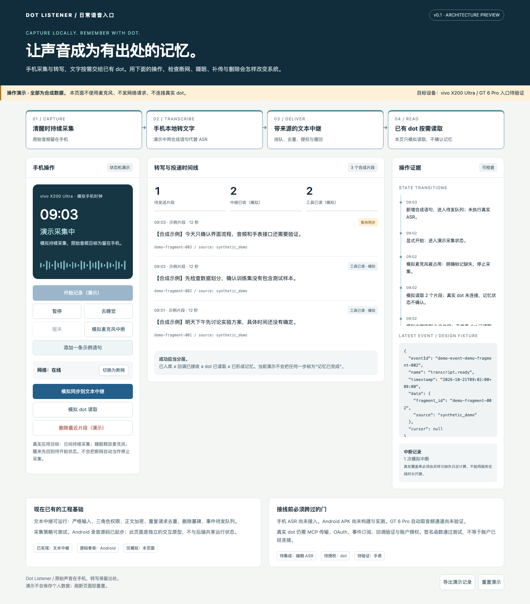
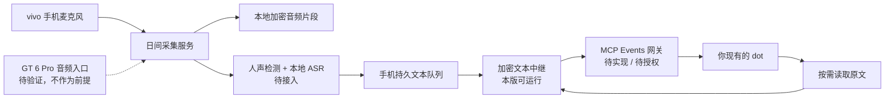

<div align="center">

# Dot Listener
## 让一天的声音，成为可追溯的记忆输入。

**vivo X200 Ultra · 本地优先 · 现有 dot · 手表入口待验证**

清醒时记录。睡眠时停止。文字在手机生成。记忆交给 dot。

**以上是产品目标。当前版本：v0.1.0 架构与工程验证版，不是全天录音成品。**

</div>

---

## 从声音，到一个不会失去出处的线索

一次讨论里可能有实验条件、一个未定日期、一项承诺。单纯留下一整天的音频，很难再次找到它们。Dot Listener 的目标是给已经在使用的 dot 增加一个稳定的语音输入端：保留时间、保留原文、保留缺失记录，把理解和记忆交给已有助手。

**设计底线：宁可显示中断，也不伪造连续；宁可保留不确定，也不替你编造结论。**

> 手机是采集与转写中心。文本中继只负责可信投递。dot 负责后续理解。
> 本仓库不复制 OPPO 的素材、品牌、私有协议或未公开算法；产品名称仅用于说明需求背景。

### 先看操作，再看结构

[打开离线交互演示](web/index.html) · [操作手册](docs/OPERATIONS.md) · [架构说明](docs/ARCHITECTURE.md) · [当前状态](docs/STATUS.md) · [官方依据](docs/SOURCES.md)

`web/index.html` 下载后可直接在浏览器打开。GitHub 源码页不会执行 HTML，请在本地打开。演示使用合成数据，不调用麦克风，不上传，不连接真实 dot。



## 一条明确的主线



## 本次交付可以实际做什么

| 内容 | 本版状态 | 证据或入口 |
|---|---|---|
| 文本入库、鉴权、加密、去重、删除、防重放恢复 | 已实现并自动测试 | `src/dot_listener/`、`tests/` |
| 睡眠与采集状态机 | Python 可执行参考；Kotlin 核心独立验证 | `state.py`、`CapturePolicy.kt` |
| 日间→断网→补传→睡眠→删除操作 | 可交互的合成演示 | `web/index.html` |
| Android 前台录音与分片加密 | 源码骨架，未构建 APK，未实机验证 | `android/` |
| SenseVoice / sherpa-onnx 手机推理 | 设计与接入验收文档；未集成权重或 JNI | `docs/ANDROID.md` |
| dot 自动接收 | 官方协议已核对；本版未连接账户 | `docs/DOT-INTEGRATION.md` |
| MCP 订阅、OAuth、网络回调 | 待实现；仅有契约及纯签名函数 | `/mcp` 明确返回 501 |
| GT 6 Pro 自动取音频至 vivo | 能力门槛，尚未验证 | `docs/WATCH-PROBE.md` |
| GitHub 远端仓库 | 已存在，公开；本版通过 PR 导入 | [zhu607705-coder/dot-listener](https://github.com/zhu607705-coder/dot-listener) |

**运行示例返回 `stored=true` 只说明中继收到文本。它不代表 dot 读到、理解或保存了记忆。**

## 本地启动

需要 Python 3.11+。以下命令在仓库根目录执行；推荐新建虚拟环境。

```bash
python3 -m venv .venv
source .venv/bin/activate
python -m pip install -e '.[dev]'
python -m pytest -q
python scripts/smoke_demo.py
```

最后一条命令使用临时数据库和合成文本，展示真实后端的入库、重传、读取与 outbox；不调用语音模型或 dot。

启动持久中继：

```bash
python scripts/init_dev.py
set -a; source .env; set +a
python -m uvicorn dot_listener.app:create_app --factory --host 127.0.0.1 --port 8765
```

在另一个终端进入同一目录并加载 `.env`：

```bash
set -a; source .env; set +a
curl -s http://127.0.0.1:8765/v1/fragments \
  -H "Authorization: Bearer $DL_INGEST_TOKEN" \
  -H 'Content-Type: application/json' --data-binary @examples/fragment.json
curl -s http://127.0.0.1:8765/v1/fragments \
  -H "Authorization: Bearer $DL_READ_TOKEN"
```

`.env` 含开发令牌和解密密钥，不能提交或公开。它没有被纳入交付包。此中继默认仅绑定回环地址，**不是可直接上线的公网服务**。

## 获取源码与贡献

现有仓库为 [zhu607705-coder/dot-listener](https://github.com/zhu607705-coder/dot-listener)，公开，采用 [Apache-2.0](LICENSE) 许可证。克隆后按上面的本地启动步骤运行；变更通过分支和 PR 审查。

```bash
git clone https://github.com/zhu607705-coder/dot-listener.git
cd dot-listener
```

### 可选：另建一个全新的私有仓库

以下脚本只用于账号 `zhu607705-coder` 下的新仓库，须在没有既有 Git remote 的独立源码副本运行，不用于更新当前仓库。默认名字已存在，因此需要指定另一个尚未使用的名字。

```bash
# macOS；已安装 GitHub CLI 时略过安装
brew install gh
gh auth login
bash scripts/publish_github.sh dot-listener-private-copy
```

脚本检查当前账号，创建新私有仓库，提交并推送允许的源码路径。发现同名仓库或既有 remote 会停止；不会修改你的其他已有仓库。首次使用 Git 时还需按提示设置本机提交身份。不会要求把令牌贴进聊天。

## 项目地图

```text
dot-listener/
├── android/                 Android 采集源码 + JVM 核心检查
├── contracts/               转写数据模型、事件和工具契约
├── docs/                    架构、操作、接入、实机验收、风险与决策
├── examples/                明确标注的合成输入
├── scripts/                 本地启动辅助、烟测、私有建仓脚本
├── src/dot_listener/         可运行的文本中继与协议纯函数
├── tests/                   自动化验证
├── evidence/                本次实际执行结果，不是真机成绩
└── web/                     无依赖的交互操作演示
```

## 先通过三个门，再谈全天

**采集门**：vivo 熄屏录音、中断记录、睡眠停止、故障恢复可验证。手表另行探针测试。

**转写门**：同一手机上测中文、英文术语、口袋和远场样本。只报告实测准确率、实时率、耗电与发热。

**投递门**：OAuth、MCP 2.0 订阅、回调验证、签名、重试与撤权完成；用你授权的 dot 验证读回原文。

详见 [任务拆分与验收](docs/ROADMAP.md)。第一版先不引入向量数据库、知识图谱或第二套大模型记忆服务。

## 安全与开源边界

仅进行已授权、可见、可停止的记录。音频默认不出手机，文本离开手机前需明确开启同步。记录他人前完成适当告知与同意；本仓库不提供法律结论。

本项目遵循仓库已有的 [Apache-2.0 许可证](LICENSE)。第三方模型和 SDK 的许可需分别核对；源码许可不等于已集成或验证这些依赖。更多见 [SECURITY.md](SECURITY.md)。
