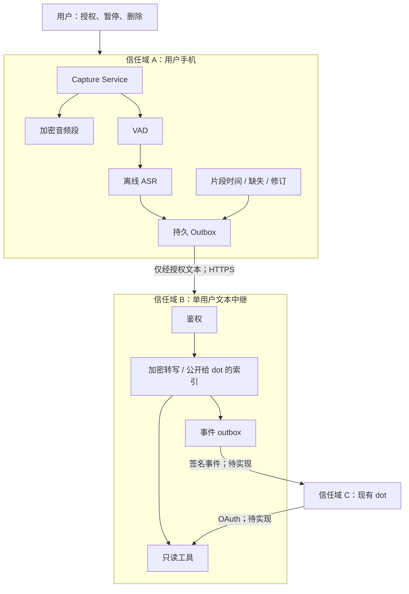
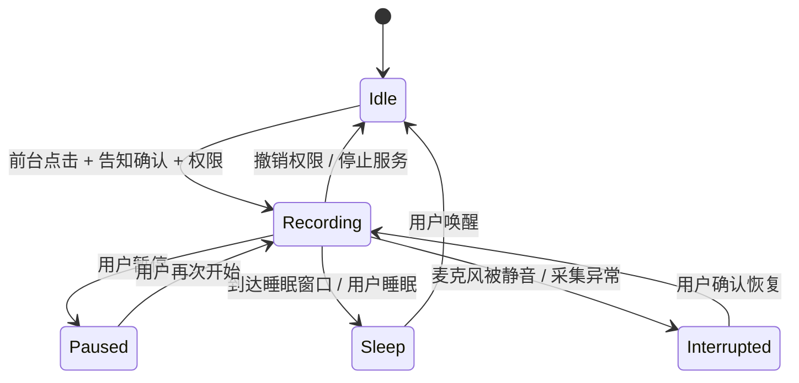
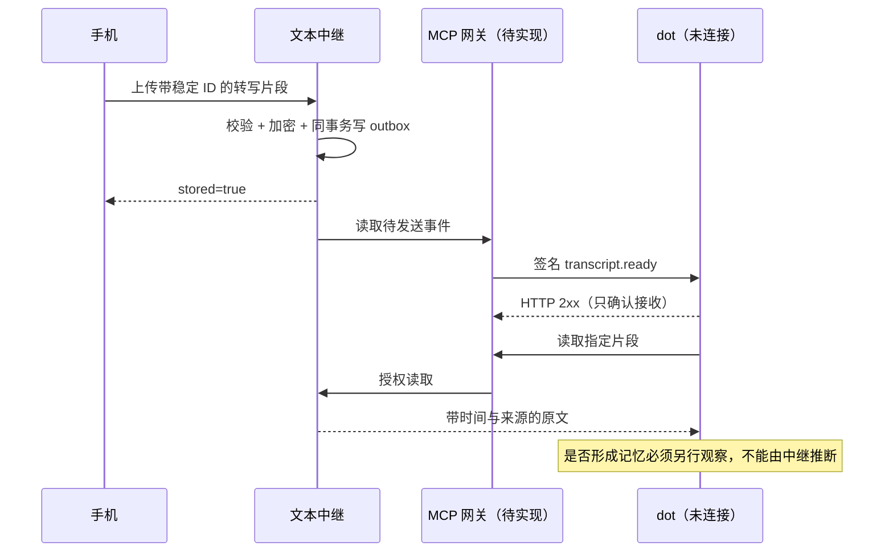

# 架构说明：把录音、转写、投递分成可验证的链路

版本：0.1.0。设计基线：2026-10-21（America/Los_Angeles）。文档是目标设计与当前实现的对照，不是上线证明。

## 1. 约束先于技术选择

| 用户约束 | 架构决定 | 禁止的替代做法 |
|---|---|---|
| 手机为 vivo X200 Ultra | Android 本地采集与 ASR 为核心 | 默认要求换成华为手机 |
| 清醒时尽可能持续记录，睡眠停止 | 持续音频分片；独立睡眠策略；显式恢复 | 用“偶尔录一句”冒充全天方案 |
| 主要在手机处理 | ASR 与人声检测留在端上 | 默认把整天音频送云端 |
| 接入现有 dot | 小型文本中继 + 官方 MCP 接入边界 | 再做一个私人聊天助手或知识图谱平台 |
| 可能用 GT 6 Pro 收音 | 设备适配器；先验证真实取音频通道 | 从系统能录音推断第三方麦克风开放 |
| 需要真实操作展示 | 演示状态机 + 可运行的后端烟测 | 把合成数据包装为真机成功 |

## 2. 系统上下文与信任边界

A 到 B 是数据离开手机的边界。B 到 C 是外部助手读取文字的边界。原音频不进入这两个传输通道。HTTPS 保护传输，加密保护中继磁盘上的正文；两者都不能保证已授权 dot 看不到文本。

## 3. 模块与责任

| 模块 | 负责 | 不负责 | 当前实现 |
|---|---|---|---|
| CaptureController | 用户动作、权限、采集状态 | 语言理解 | 状态参考 + Android 骨架 |
| AudioSegmentStore | 分段、加密、崩溃残留识别 | 云上传 | Android AES-GCM 分段源码 |
| SleepPolicy | 手机本地时间窗口、手动睡眠 | 医学睡眠判定 | 已有纯策略；实机待测 |
| VoiceActivityGate | 控制何时启动 ASR | 决定是否保留原音 | 设计 |
| OnDeviceTranscriber | PCM 转文本与标记 | 摘要、承诺推断 | 设计 |
| TranscriptOutbox | 稳定 ID、落盘、重试、断网排队 | 直接修改 dot 记忆 | 设计 |
| TextRelay | 去重、正文加密、权限、删除 | ASR、语义总结 | 已实现 |
| MCPGateway | 官方工具与事件、OAuth | 从录音执行任意命令 | 契约，待实现 |

## 4. 采集与转写有两条队列

**音频线**持续把采到的样本写入加密分片，包含静音。不因为 VAD 判断无声就丢掉完整记录。

**转写线**只对人声窗口做推理。VAD 是计算调度器，不是事实裁判。漏掉轻声后仍可依据完整音频补转。

建议初始参数是设计起点：16 kHz、单声道、16-bit PCM；音频每约 30 秒提交一段；ASR 以短窗口处理并保留边界重叠。不得把这些参数描述成已优化的 X200 Ultra 设置。

未经压缩的上述 PCM 是 32,000 字节/秒，16 小时约 1.8432 GB（十进制，未计容器与加密开销）。本版 Android 骨架保存加密 PCM，**不享有压缩编码节省的空间**。后续采用压缩归档须独立验收编码、耗电与补转质量。

## 5. 状态机

网络状态与采集状态分离。断网不等于停止录音，网络恢复也不等于重新打开麦克风。`Sleep → Idle` 不直接转到 `Recording`。这避免把计划中的自动恢复错误地做成隐蔽重启。

Android 官方对麦克风前台服务及后台启动设有约束；手机厂商的后台行为还需实机确认。依据见 [S1、S2](SOURCES.md)。

## 6. 数据实体与不变量

### Session

一个明确授权的记录会话。目标字段：`session_id`、用户开始/结束动作、睡眠策略版本、允许文本同步的开关、手机时区。v0.1 中继只接收 session ID，不管理完整会话表。

### AudioSegment（只在手机）

记录格式、采样数、单调时钟起止、墙钟起止、加密 key alias、文件提交状态。`.part` 表示尚未完成，不应当伪装成可回听成功的片段。本版源码实现加密分片；完整元数据日志和恢复器还未完成。

### TranscriptFragment（已实现契约）

`id`、`session_id`、带时区起止时间、IANA 时区、原文、来源、ASR 标识、语言、`publish_to_dot`。

文本必须来自转写或明确合成样例。第一版不做说话人实名识别。时间存 UTC，并保留原时区；“明天”按录音发生时间理解，不按处理服务器当前日期推断。

### Publication / EventOutbox（已实现）

公开给 dot 的索引有独立递增序号。未发布的旧片段稍后获准发布时，得到新的索引序号，不会被已经前移的读取游标漏掉。删除产生新的墓碑索引，并取消待发送的创建事件。

**不变量**：同 ID 同负载只写一次；同 ID 不同负载冲突；已删除 ID 再上传返回 410；未发布片段对只读令牌隐藏；原文不进事件通知。

## 7. 投递序列：把“成功”拆开

此序列中，前两次中继交互已能通过本地 API 演示。MCP 网络步骤是目标流程。官方 MCP Events 文档明确区分回调接收与异步处理，不能把 2xx 当作完成记忆。[S3](SOURCES.md)

## 8. 故障语义

| 故障 | 可见状态 | 保存什么 | 恢复策略 |
|---|---|---|---|
| 手机断网 | 文本待发送；采集可继续 | 音频、文字、稳定 ID | 联网补传；重复请求幂等 |
| 手机进程死亡 | 未验证 / 中断 | 已提交音频段 | 扫描 `.part`；标记缺失；不暗中重启 |
| ASR 失败 | 待补转 | 原音频 | 重试或用户选段；不填充虚构文字 |
| 低存储 | 可见错误并停止 | 已提交分片 | 用户处理；不静默覆盖旧记录 |
| 服务器重启 | 请求可重试 | SQLite 与 outbox | 同 ID 重传不重复 |
| 同步权限撤销 | 未发布 / 不可读取 | 按用户选择保留本地 | 停止发出；已传远端单独处理 |
| dot 未连接 | 未投递 | 中继原文与待发事件 | 完成授权和网关后接线 |

## 9. 刻意不做的事

第一版不做自动发邮件、自动删文件、未确认的承诺执行，不把环境里的话当工具指令，不做隐蔽录音，不尝试解锁华为固件，不承诺 24 小时免干预，不假设系统录音机能自动导出。

## 10. 边界验收

核心验收不是“页面有个球在转”。要能证明：某段音频确实采到了；某句话能追溯到片段；睡眠后麦克风释放；中断可见；文字未获同步授权时不被读到；重传不生成两份；删除后旧队列不会再把它恢复。
